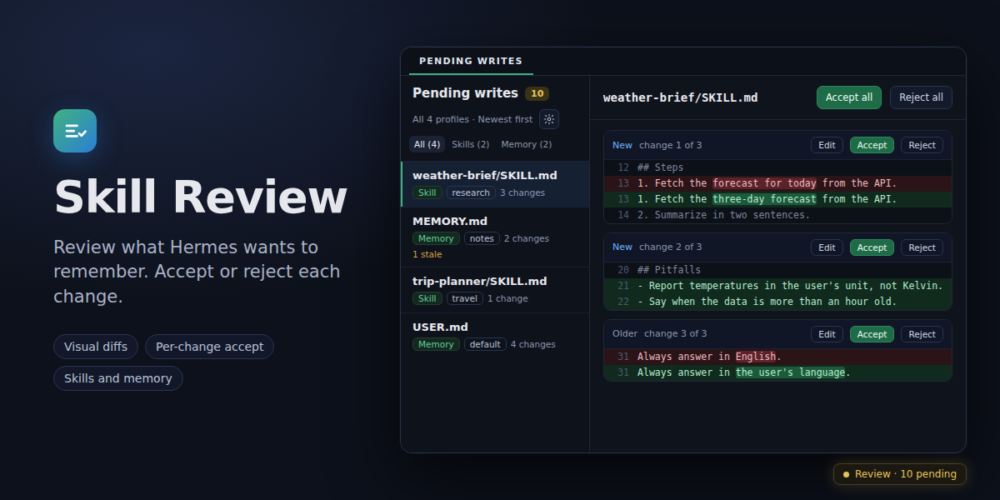

# Skill Review



Skill Review is a Hermes Desktop plugin with a Python backend that shows staged skill and memory writes as visual diffs on one review page, where you accept or reject each proposed change. Its Library mode lists each profile's identity, memory and skill files and edits them in place.

## What it does

With `skills.write_approval` or `memory.write_approval` on, Hermes does not write skill or memory changes straight to disk. It stages each one as a pending write. Skill Review lists those writes through Hermes's public write review API and shows them in Desktop.

- Skill review in the sidebar opens the review page in the main area, the way Memory Wiki and Kanban open theirs. The page shows the profile Desktop is connected to and lists every file with pending changes once: a `SKILL.md` or supporting file, `MEMORY.md` or `USER.md`. A write that changes several files is one entry.
- Each change is its own block in the file's diff, drawn from Hermes's preview of the write. Hermes accepts or rejects a write only as a whole, so the file has Accept all and Reject all (Accept and Reject when it holds one change) and the blocks have no buttons of their own. A file with a write of several changes says so above the diff.
- After a decision the page says what happened in one sentence: accepted, rejected (with Hermes's warning, if it gave one), already decided elsewhere, refused with Hermes's reason, stale, staged after you loaded the file, or stopped partway.
- A write Hermes stopped partway through applying is counted above the list, with the `/skills reject <id>` or `/memory reject <id>` command that clears it.
- Blocks staged since you last opened the file are marked New. Earlier ones are marked Older.
- Changed lines get word-level highlights.
- Filters show skills, memory or all. You can sort the list by newest, oldest, name or number of changes.
- A Review button in the status bar shows the pending count. Click it to open the page. Right-click it to pick the notification mode.
- New changes show a popup with an Open button or light up the Review button, as you choose. Nothing opens the page by itself.
- Settings live under Settings > Plugins > Skill Review.

### Library

Two buttons under the page title, Pending N and Library, switch what the page shows. Pending is the review list above.

- Library lists the connected profile's files in three groups: Identity (`SOUL.md`, `PROJECT.md`, `AGENTS.md`, each when it exists in the profile folder), Memory (`MEMORY.md`, `USER.md`) and Skills (each skill in the profile's own skills folder with its `SKILL.md` and the text files under `references/`, `templates/`, `scripts/` and `assets/`). Skills come from Hermes's public skill catalog helpers. Library lists only files inside the profile folder: skills in external skill folders from `skills.external_dirs` are not listed, and a file is left out when any part of its path below the profile folder is a symlink.
- Identity files are editable. Memory and skill files are read-only: each group says which, and a read-only file opens with a short note. Hermes has no public way yet to check and lock memory and skill files when another program saves them, so change those through the agent and review the change under Pending.
- Every skill and file row shows how many pending changes it has. Pending changes to files that are not in the library, such as a new skill or a skill in an external skill folder, are listed under "Only in Pending" and open in Pending. The counts add up to the Pending total.
- The search box filters by file or skill name.
- Selecting a file opens it in an editor with line numbers and word wrap (Wrap lines in the footer turns it off). For an identity file, Save writes the text straight to the file, with no staging, and Revert puts back the text you opened. A file with unsaved text has a blue dot in the list, and switching to another file, to Pending or to the settings asks before it drops the text.
- If the file has pending changes, a link above the editor opens them in Pending.
- Save refuses if the file changed on disk since you opened it, and offers Reload. Reload replaces your text with the file as it is now. Identity files can be at most 200,000 characters.

## Requirements

- Hermes 0.23.2 or newer, with Hermes Desktop.
- Library mode needs a backend on Linux or macOS. It opens files through folder handles without following symlinks, which Windows does not offer, so there the Library view shows that message and lists nothing. Pending works on every system.
- The write-approval gate turned on in every profile you want to review. The keys are `skills.write_approval` and `memory.write_approval`. Both default to off.

```bash
hermes config set skills.write_approval true
hermes config set memory.write_approval true

# for a named profile
hermes -p <profile> config set skills.write_approval true
```

In chat, `/skills approval on` and `/memory approval on` set the same keys.

## Install

From the plugin catalog, once the plugin is listed there:

```bash
hermes plugins install skill-review
```

From GitHub:

```bash
hermes plugins install https://github.com/hosakb/hermes-skill-review
# or the owner/repo shorthand
hermes plugins install hosakb/hermes-skill-review
```

The install asks whether to enable the plugin. To enable it later, run `hermes plugins enable skill-review`, which adds it to `plugins.enabled` in `config.yaml`. The Python backend loads only when it is on that list.

Then turn on the Desktop half in Desktop under Capabilities > Plugins. It starts off.

The gateway imports the Python backend when it starts. After an install or update, restart the backend (for example `hermes gateway restart`) and reload Desktop so both halves run the same version.

## How it works

`dashboard/plugin_api.py` mounts routes under `/api/plugins/skill-review/` in the gateway. For the profile the gateway scoped the request to, it lists the pending writes with `list_writes`, previews each one with `preview_write` and groups the previewed changes by target file. These functions come from `tools.write_review_api`, Hermes's public write review API. The plugin does not open the pending queue itself.

`desktop/plugin.js` asks the backend for the list every 3 seconds through `ctx.rest`. It draws the page, its sidebar row, the Review button and the settings page.

Every preview carries an opaque `expect` value. Accept all and Reject all send back the `expect` of each write shown, unchanged, and the backend passes it to `decide_write`. Hermes checks it under its own locks, so a write that changed since the preview is refused and stays pending. Before an accept the backend previews the write again: a write that is now stale or in conflict is reported with Hermes's reason and Hermes is not asked. A write staged after the file was loaded has no `expect` on the page, so it stays pending.

Without `tools.write_review_api` every Pending route answers with one message that a newer Hermes is needed. Nothing falls back to other code.

Library uses `GET /library` for the tree and `GET` and `PUT /library/<profile>/<key>` for one file. The key is an opaque value the backend builds; on every request the backend lists the files it allows for that profile again and looks the key up there, so the Desktop half never sends a path. A file is on that list only when it is inside the profile folder, no part of its path below that folder is a symlink, and, for a skill file, it is inside its own skill folder. `PUT` saves identity files only and answers 403 for memory and skill files.

Every read and save opens the file's folder from the profile folder one path part at a time without following symlinks, then opens the file without following a symlink and without waiting on a FIFO. It refuses anything that is not a regular file, a file with a second hard link and a file over 1 MB, judged on the opened file. A symlink swapped in anywhere on the path after the lookup makes that open fail, so a read never returns an outside file and a save never writes through a link.

A save holds the plugin's own lock file, looks the key up again, reads the file and notes its folder and file identity. It compares the SHA-256 of the file's bytes with the one from when you opened it and checks that the text is valid UTF-8 of at most 200,000 characters. Then it opens the folder again the same way and writes only if the folder and the file are the same ones it read. It writes a temporary file in that folder, gives it the old file's permissions and, where the system allows it, the old file's owner and group, flushes it to disk and renames it over the file, both relative to the opened folder, so the text lands in the folder that was checked. A process that does not take this lock and rewrites the file in place in the moment between that last check and the rename can still lose its change, as with any edit of a shared file.

## Disclosure

- No network calls. The Desktop half talks only to the Hermes backend it runs against, through `ctx.rest`. The backend makes no outgoing connections.
- No telemetry and no usage reporting.
- No credentials. The plugin reads no secrets, tokens or `.env` files.
- No tools, hooks, shell commands or background processes. The Python `register()` does nothing.
- It uses only Hermes's public plugin API. Pending calls `tools.write_review_api` (`list_writes`, `preview_write`, `decide_write`) for the profile Desktop is connected to. The plugin does not open, rewrite or rename anything under `<HERMES_HOME>/pending/`, and it does not replace or wrap any Hermes function.
- On Accept all or Reject all, the plugin calls `decide_write` with the `expect` value of the preview you looked at. Hermes then applies or drops the whole write with its own checks and locks, the same as `/skills approve` or `/memory approve`.
- Previews carry memory text and skill diffs to Desktop. The backend does not log, cache or store them.
- Library reads the connected profile's `SOUL.md`, `PROJECT.md`, `AGENTS.md`, `MEMORY.md` and `USER.md`, and the files of each skill in the profile's own skills folder: `SKILL.md` and the text files under `references/`, `templates/`, `scripts/` and `assets/`. It finds those skills through Hermes's public skill catalog helpers (`find_all_skills`, `locate_skill`, `skill_search_dirs`). It does not read external skill folders.
- On Save in Library, the plugin writes that one identity file itself: `SOUL.md`, `PROJECT.md` or `AGENTS.md`, and only after you press Save. It does not write memory or skill files. To serialise saves it holds a lock file at `<HERMES_HOME>/plugin-data/skill-review/library.lock`, in the plugin's own data folder.
- The Desktop half stores its settings in Desktop plugin storage: notification mode, sort order, which changes it already announced and when you last opened each file. The Wrap lines choice is kept in the page's local storage.

## Known limits

- Pending needs a Hermes with the public write review API, `tools.write_review_api` (Hermes PR #158550, not yet in a release). On an older Hermes the page shows one message saying a newer Hermes is needed, and Library still lists and opens files and saves identity files, without pending counts.
- The page shows only the profile Desktop is connected to. To review another profile, switch to it in Desktop. The public API offers no way to reach other profiles from one request.
- Hermes accepts or rejects a staged write only as a whole, so this version has no Accept or Reject per change. Accept all and Reject all decide every write of the file you are looking at.
- Accept all and Reject all decide only the writes you saw. A write staged after the file was loaded stays pending until you look at it. A write that changed since its preview is refused by Hermes and stays pending.
- This version cannot edit a proposed change or remove a memory entry entirely: the public API has no way to change a staged write.
- The diff shows each change as Hermes previews it, without the unchanged lines of the file around it.
- Library opens `MEMORY.md`, `USER.md` and skill files read-only. A save of those files must pass Hermes's own checks under Hermes's locks (the memory character limit and threat scan; the skill size limit, frontmatter, 60-character description and Skills Guard scan), and Hermes has no public helper for those yet.
- A write whose approval stopped partway (`needs_review`) is counted above the list but not shown, because the public API does not return its id. Check the files, then close it in chat with `/memory reject <id>` or `/skills reject <id>`.
- Library finds skills through Hermes's skill catalog, so a skill that the catalog hides on this platform or has disabled is not listed.
- The review page takes the main area while it is open, as Memory Wiki and Kanban do. Pick a chat in the sidebar to go back.
- After an update, reload Desktop and restart the backend before the new version runs.
- Word highlights stop at 2,500 tokens per line and 4,000,000 comparison cells per line pair (16,000,000 per block). Longer lines are tinted without word marks. Diffs themselves are not truncated.
- Library opens UTF-8 text files of at most 1 MB. It lists supporting files only under `references/`, `templates/`, `scripts/` and `assets/`, and leaves out files that are not UTF-8 text.
- Once you edit a file with Windows line endings in Library, it is saved with Unix line endings, because the browser's text box turns every line ending into a line feed.
- Closing or reloading Desktop, or leaving the page from the sidebar, with unsaved text in Library does not ask first. The Desktop plugin SDK has no hook for that; switching files, switching to Pending, Back and the settings gear ask. Text left this way stays in Library until Desktop reloads: the page opens on that file again and shows "Unsaved changes in" the file next to the Library button.
- Library leaves out a file that has a second hard link, and refuses one that gains a link after the list was read. It leaves out a file reached through a symlink, even one that points inside the profile folder. A skill whose `SKILL.md` is left out this way is left out whole, with its other files.
- Library writes identity files directly. A Hermes process that holds a file's text in memory, such as a running chat with `SOUL.md` already in its prompt, sees the new text only when it reads the file again.

## Development

The JavaScript tests use Node's built-in test runner and need no install:

```bash
node --test tests/js/*.test.mjs
```

The Python tests import Hermes from a checkout of the Hermes source repository. Run them with a Python that has Hermes's dependencies and pytest installed, for example the Hermes virtual environment:

```bash
HERMES_AGENT_SRC=/path/to/hermes-source python -m pytest -q tests
```

Each test builds a throwaway Hermes root in a temporary folder and never touches `~/.hermes`.

## License

MIT. See [LICENSE](LICENSE).
